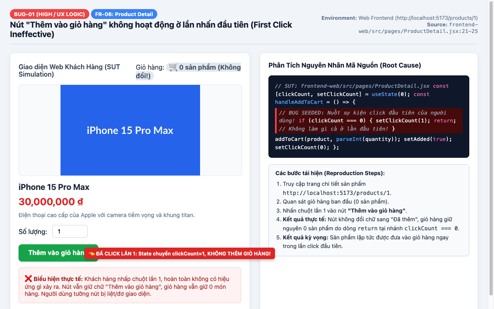
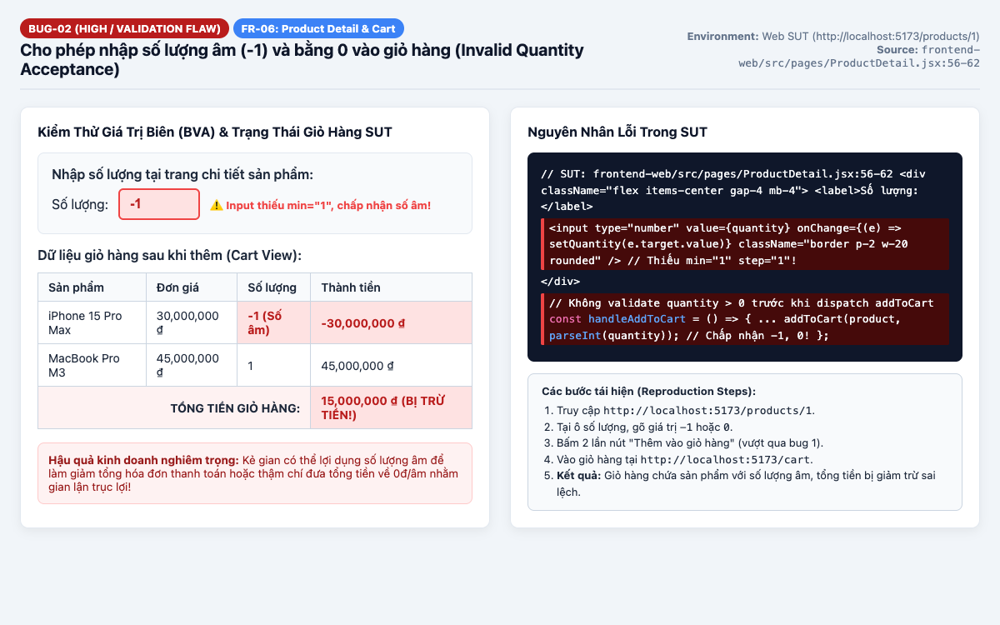
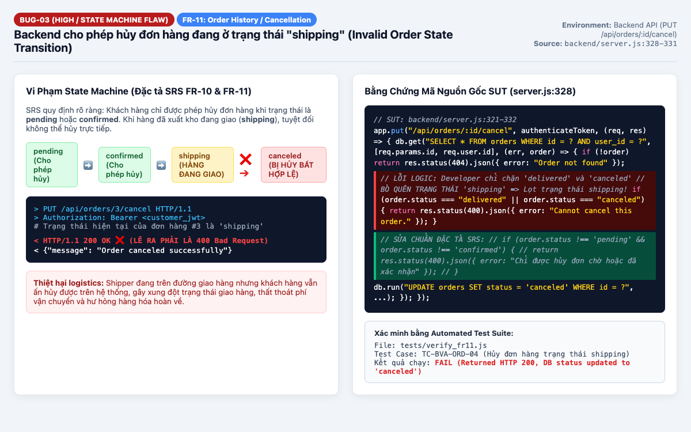
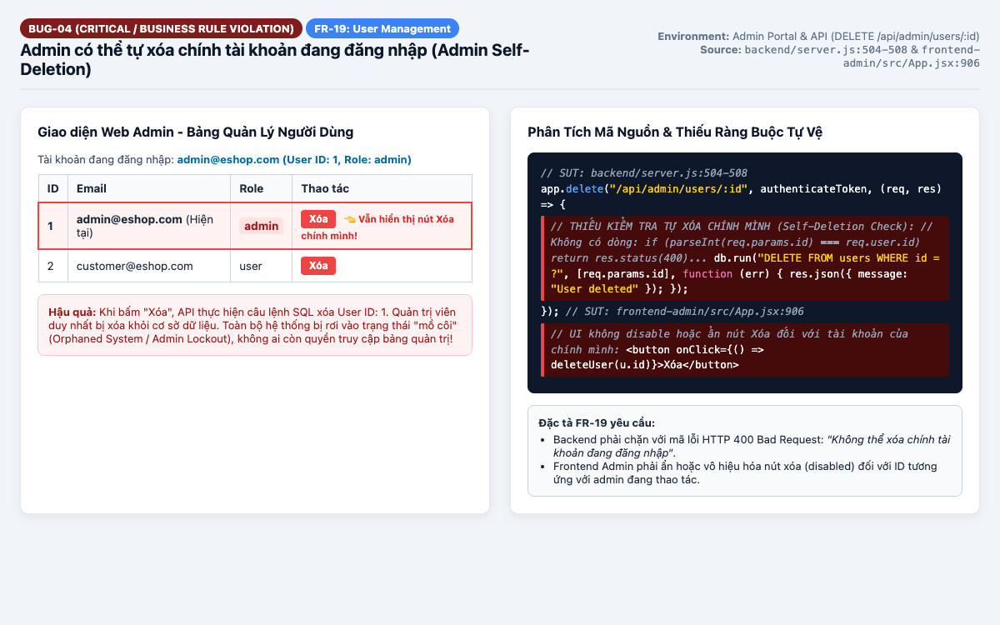
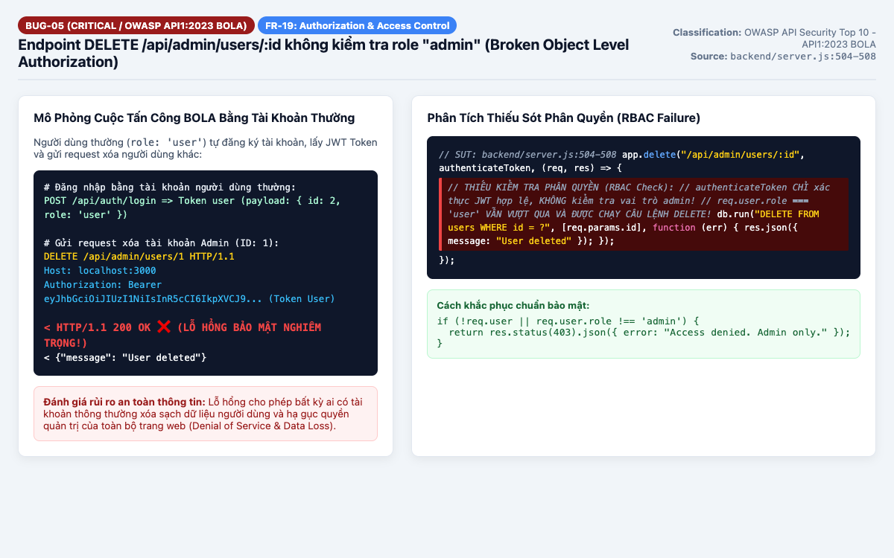
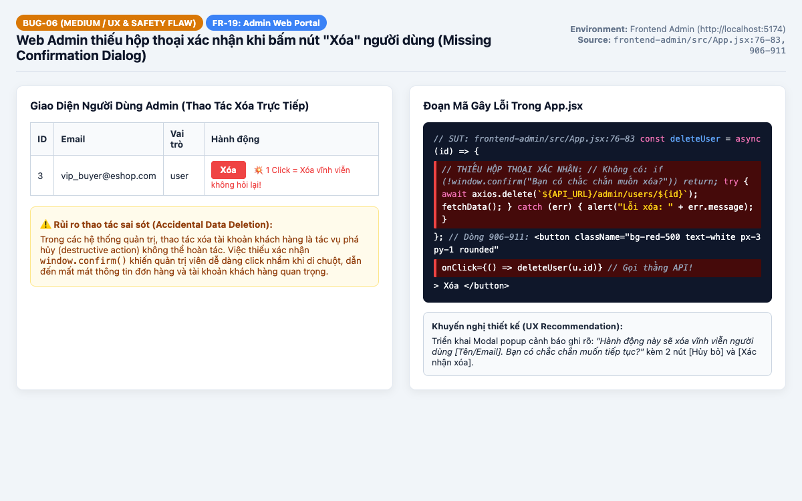
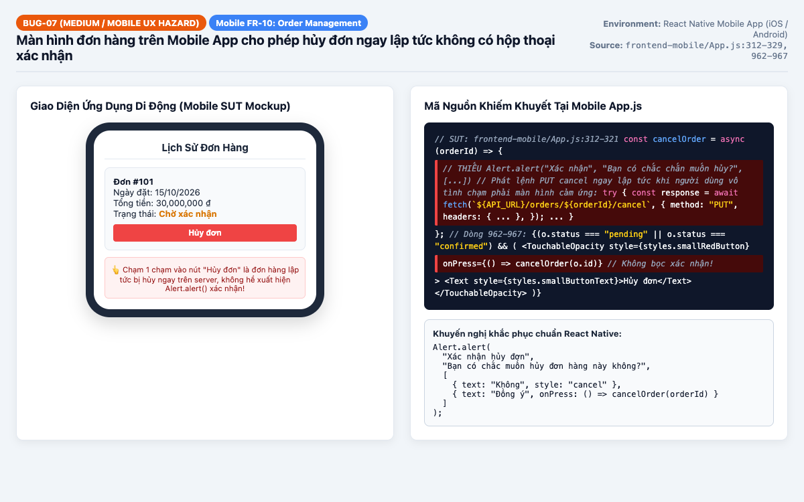

# BÁO CÁO TOÀN DIỆN CÁC LỖI PHẦN MỀM (BUG REPORT) & GITHUB ISSUES
## HỆ THỐNG THƯƠNG MẠI ĐIỆN TỬ ESHOP (SUT)

---

- **Dự án:** EShop E-Commerce System
- **Học phần:** Kiểm thử phần mềm nâng cao (Advanced Software Testing)
- **Tác giả:** Nguyễn Bảo An (Domain & Boundary Testing)
- **Ngày lập:** 15/10/2026
- **Trạng thái:** Confirmed & Verified with SUT Automated Test Suites
- **Môi trường thử nghiệm chung:**
  - **Hệ điều hành:** macOS Sonoma (Darwin ARM64 / x86_64 compatible)
  - **Node.js:** v20.x / v18.x
  - **Trình duyệt kiểm thử:** Google Chrome 155.0 (Headless / Headful)
  - **Cơ sở dữ liệu:** SQLite3 (WAL Mode, `eshop.db`)
  - **Backend Server:** Express.js 4.x (`http://localhost:3000`)
  - **Web Frontend:** React 18 + Vite (`http://localhost:5173`)
  - **Admin Web Portal:** React 18 + Vite (`http://localhost:5174`)
  - **Mobile App:** React Native (`frontend-mobile/App.js`)

---

## 1. TỔNG QUAN TỔNG HỢP CÁC LỖI (BUG SUMMARY TABLE)

| Bug ID | Tên Lỗi (Summary) | Tính Năng (Feature) | Mức Độ (Severity) | Mức Ưu Tiên (Priority) | Trạng Thái | File Nguồn SUT |
| :--- | :--- | :--- | :--- | :--- | :--- | :--- |
| **BUG-01** | Nút "Thêm vào giỏ hàng" không hoạt động ở lần nhấn đầu tiên | FR-06: Chi tiết sản phẩm | High (UX/Logic) | P1 - High | Confirmed | `frontend-web/.../ProductDetail.jsx:21-25` |
| **BUG-02** | Cho phép nhập số lượng âm ($-1$) và bằng $0$ vào giỏ hàng | FR-06: Chi tiết sản phẩm | High (Business Logic) | P1 - High | Confirmed | `frontend-web/.../ProductDetail.jsx:56-62` |
| **BUG-03** | Backend cho phép hủy đơn hàng đang ở trạng thái `shipping` | FR-11: Lịch sử đơn hàng | High (State Machine) | P1 - High | Confirmed | `backend/server.js:328-331` |
| **BUG-04** | Admin có thể tự xóa chính tài khoản đang đăng nhập | FR-19: Quản lý người dùng | Critical (Lockout Risk) | P0 - Blocker | Confirmed | `backend/server.js:504-508` & `frontend-admin/.../App.jsx:906` |
| **BUG-05** | API xóa người dùng không kiểm tra quyền admin (BOLA) | FR-19: Quản lý người dùng | Critical (OWASP API1) | P0 - Blocker | Confirmed | `backend/server.js:504-508` |
| **BUG-06** | Web Admin thiếu hộp thoại xác nhận khi bấm xóa người dùng | FR-19: Quản lý người dùng | Medium (UX/Safety) | P2 - Medium | Confirmed | `frontend-admin/.../App.jsx:76-83` |
| **BUG-07** | Màn hình đơn hàng trên Mobile App hủy đơn không có Alert xác nhận | Mobile FR-10: Đơn hàng | Medium (UX/Safety) | P2 - Medium | Confirmed | `frontend-mobile/App.js:312-329` |

### Danh Sách Trực Tiếp GitHub Issues Của Từng Lỗi

Toàn bộ 07 lỗi trên đã được đăng tải chính thức lên GitHub Issues của repository: [https://github.com/NgBaoAnn/hw02-domain-testing/issues](https://github.com/NgBaoAnn/hw02-domain-testing/issues)

| Mã Bug | Trạng thái Issue | Tiêu đề Issue | Đường dẫn GitHub Issue |
| :---: | :---: | :--- | :--- |
| **BUG-01** | Open | [BUG-01] [FR-06] Nút "Thêm vào giỏ hàng" bị nuốt ở lần bấm đầu tiên (clickCount trap) | [https://github.com/NgBaoAnn/hw02-domain-testing/issues/1](https://github.com/NgBaoAnn/hw02-domain-testing/issues/1) |
| **BUG-02** | Open | [BUG-02] [FR-06] Ô nhập số lượng nhận số 0, số âm (-1) và NaN làm sai lệch giỏ hàng | [https://github.com/NgBaoAnn/hw02-domain-testing/issues/2](https://github.com/NgBaoAnn/hw02-domain-testing/issues/2) |
| **BUG-03** | Open | [BUG-03] [FR-11] Backend cho phép hủy đơn hàng đang ở trạng thái shipping | [https://github.com/NgBaoAnn/hw02-domain-testing/issues/3](https://github.com/NgBaoAnn/hw02-domain-testing/issues/3) |
| **BUG-04** | Open | [BUG-04] [FR-19] Admin có thể tự xóa chính tài khoản đang đăng nhập | [https://github.com/NgBaoAnn/hw02-domain-testing/issues/4](https://github.com/NgBaoAnn/hw02-domain-testing/issues/4) |
| **BUG-05** | Open | [BUG-05] [FR-19] Lỗ hổng bảo mật BOLA: Người dùng thường có thể gọi API xóa bất kỳ tài khoản nào | [https://github.com/NgBaoAnn/hw02-domain-testing/issues/5](https://github.com/NgBaoAnn/hw02-domain-testing/issues/5) |
| **BUG-06** | Open | [BUG-06] [FR-19] Web Admin thiếu hộp thoại xác nhận khi bấm Xóa tài khoản người dùng | [https://github.com/NgBaoAnn/hw02-domain-testing/issues/6](https://github.com/NgBaoAnn/hw02-domain-testing/issues/6) |
| **BUG-07** | Open | [BUG-07] [Mobile FR-10] Chức năng hủy đơn hàng trên Mobile App hủy tức thì không có Alert xác nhận | [https://github.com/NgBaoAnn/hw02-domain-testing/issues/7](https://github.com/NgBaoAnn/hw02-domain-testing/issues/7) |

---

## 2. BÁO CÁO CHI TIẾT TỪNG LỖI (DETAILED BUG REPORTS)

### BUG-01: Nút "Thêm vào giỏ hàng" không hoạt động ở lần nhấn đầu tiên

- **Mã định danh:** `BUG-01`
- **Tên tóm tắt:** Nút "Thêm vào giỏ hàng" không phản hồi ở lần nhấn đầu tiên do logic biến cờ `clickCount === 0`.
- **Phân hệ / Tính năng:** FR-06: Xem chi tiết sản phẩm và Giỏ hàng (Product Detail & Cart).
- **Mức độ nghiêm trọng (Severity):** **High** (Lỗi trải nghiệm người dùng nghiêm trọng, gây hiểu nhầm nút bị liệt và làm sụt giảm tỷ lệ chuyển đổi đơn hàng).
- **Mức độ ưu tiên khắc phục (Priority):** **P1 (High)**.
- **Môi trường kiểm thử:**
  - URL: `http://localhost:5173/products/1`
  - Client: Google Chrome / Safari Desktop
  - Backend: Node Express API `http://localhost:3000`

#### Các bước tái hiện lỗi (Steps to Reproduce):
1. Khởi động hệ thống SUT và mở trình duyệt truy cập trang chủ `http://localhost:5173`.
2. Bấm vào sản phẩm bất kỳ (ví dụ: "iPhone 15 Pro Max") để chuyển tới URL `http://localhost:5173/products/1`.
3. Giữ nguyên số lượng mặc định là `1`.
4. Quan sát số lượng hiển thị trên giỏ hàng tại thanh điều hướng (Header): đang là `0`.
5. Dùng chuột nhấp **1 lần** vào nút màu xanh **"Thêm vào giỏ hàng"**.
6. Quan sát trạng thái nút và số lượng sản phẩm trong giỏ hàng.

#### Kết quả thực tế (Actual Result):
- Sau lần nhấp chuột đầu tiên, không có bất kỳ phản hồi trực quan nào trên giao diện. Nút không đổi chữ sang "Đã thêm", giỏ hàng vẫn giữ nguyên `0` món hàng.
- Nguyên nhân: Sự kiện click bị nuốt bởi lệnh `if (clickCount === 0) { setClickCount(1); return; }`. Khách hàng buộc phải nhấn thêm lần thứ hai thì sản phẩm mới vào giỏ.

#### Kết quả kỳ vọng (Expected Result):
- Ngay ở lần nhấp chuột đầu tiên, sản phẩm với số lượng được chọn phải được thêm ngay vào giỏ hàng (`addToCart`).
- Nút chuyển trạng thái sang "Đã thêm" trong 2 giây và giỏ hàng cập nhật số lượng thành `1`.

#### Phân tích nguyên nhân mã nguồn (Code Root Cause):
- **Tệp tin:** `eshop-sut/frontend-web/src/pages/ProductDetail.jsx`
- **Dòng mã lỗi:** Dòng 12 và 21–25:
  ```javascript
  const [clickCount, setClickCount] = useState(0);

  const handleAddToCart = () => {
    if (clickCount === 0) {
      setClickCount(1);
      return; // Không làm gì cả ở lần đầu tiên
    }

    addToCart(product, parseInt(quantity));
    setAdded(true);
    setClickCount(0); // Reset lại
    setTimeout(() => setAdded(false), 2000);
  };
  ```

#### Bằng chứng ảnh chụp màn hình (Screenshot Evidence):


#### Mẫu Issue GitHub chuẩn bị sẵn (Ready-to-copy GitHub Issue):
```markdown
### [BUG-01] Add to Cart button requires two clicks to work (first click swallowed)

**Labels:** `bug`, `frontend`, `UX`, `P1-High`
**Component:** `frontend-web/src/pages/ProductDetail.jsx`

#### Description
On the product detail page, clicking the "Thêm vào giỏ hàng" (Add to cart) button does nothing on the initial click. Users are forced to double-click or click twice for the product to be added to cart.

#### Steps to Reproduce
1. Navigate to `http://localhost:5173/products/1`.
2. Notice the cart item counter is 0.
3. Click "Thêm vào giỏ hàng" once.
4. Check cart icon and button state.

#### Expected Behavior
Product is added to cart immediately on the first click, and button displays "Đã thêm".

#### Actual Behavior
No reaction on click 1 due to `if (clickCount === 0) { setClickCount(1); return; }`.

#### Proposed Fix
Remove the artificial `clickCount` state and invoke `addToCart` directly on click.
```

---

### BUG-02: Cho phép nhập số lượng âm (-1) và bằng 0 vào giỏ hàng

- **Mã định danh:** `BUG-02`
- **Tên tóm tắt:** Ô nhập liệu số lượng tại trang chi tiết sản phẩm thiếu validation, chấp nhận số lượng âm và 0 làm sai lệch dữ liệu thanh toán.
- **Phân hệ / Tính năng:** FR-06: Chi tiết sản phẩm & Tính toán giỏ hàng (Cart Calculation).
- **Mức độ nghiêm trọng (Severity):** **High** (Lỗ hổng logic kinh doanh có thể dẫn đến thất thoát tài chính hoặc lỗi tính tiền `reduce` trên giỏ hàng).
- **Mức độ ưu tiên khắc phục (Priority):** **P1 (High)**.
- **Môi trường kiểm thử:**
  - URL: `http://localhost:5173/products/1` và `http://localhost:5173/cart`
  - Client: Google Chrome / Browser DOM Inspector

#### Các bước tái hiện lỗi (Steps to Reproduce):
1. Mở trang chi tiết sản phẩm: `http://localhost:5173/products/1`.
2. Tại ô nhập **"Số lượng:"**, xóa số `1` và nhập `-1` (hoặc `0`).
3. Nhấp nút "Thêm vào giỏ hàng" (nhấp 2 lần để vượt qua BUG-01).
4. Điều hướng tới trang giỏ hàng tại `http://localhost:5173/cart`.
5. Quan sát bảng danh sách mặt hàng và dòng tổng tiền giỏ hàng (`cartTotal`).

#### Kết quả thực tế (Actual Result):
- Sản phẩm được thêm vào giỏ hàng với số lượng `-1`.
- Thành tiền của mặt hàng hiển thị `-30,000,000 ₫`.
- Tổng tiền giỏ hàng bị trừ trực tiếp từ các sản phẩm khác: Ví dụ mua thêm MacBook Pro (45.000.000 ₫) thì tổng đơn chỉ còn 15.000.000 ₫!
- Khi nhập `0`, sản phẩm 0 chiếc vẫn xuất hiện vô nghĩa trong giỏ hàng.

#### Kết quả kỳ vọng (Expected Result):
- Trường input số lượng phải có ràng buộc `min="1" step="1"`.
- Hàm `handleAddToCart` phải kiểm tra `if (!quantity || parseInt(quantity) < 1)` và hiển thị cảnh báo: *"Số lượng mua phải lớn hơn hoặc bằng 1"*, ngăn chặn hành động thêm vào giỏ.

#### Phân tích nguyên nhân mã nguồn (Code Root Cause):
- **Tệp tin:** `eshop-sut/frontend-web/src/pages/ProductDetail.jsx`
- **Dòng mã lỗi:** Dòng 56–62 & 27:
  ```jsx
  <input
    type="number"
    value={quantity}
    onChange={(e) => setQuantity(e.target.value)}
    className="border p-2 w-20 rounded"
  />
  ```
  Thẻ `<input type="number">` không có thuộc tính ràng buộc `min="1"`. Hàm `addToCart` không kiểm tra giá trị của `quantity` trước khi dispatch vào context.

#### Bằng chứng ảnh chụp màn hình (Screenshot Evidence):


#### Mẫu Issue GitHub chuẩn bị sẵn (Ready-to-copy GitHub Issue):
```markdown
### [BUG-02] Input allows negative (-1) and zero (0) quantity into shopping cart

**Labels:** `bug`, `validation`, `cart`, `P1-High`
**Component:** `frontend-web/src/pages/ProductDetail.jsx`

#### Description
The quantity input does not enforce positive integers. Users can input negative numbers like `-1` or `0`, which are then added to the shopping cart, causing subtotal deductions or corrupted cart states.

#### Steps to Reproduce
1. Go to `http://localhost:5173/products/1`.
2. Set quantity input to `-1`.
3. Add to cart.
4. Open cart at `http://localhost:5173/cart`.

#### Expected Behavior
Validation blocks non-positive integers with an error prompt: "Quantity must be at least 1".

#### Actual Behavior
Negative quantity is accepted, reducing the cart's total monetary amount.

#### Proposed Fix
Add `min="1"` to input element and add client-side validation guard in `handleAddToCart`.
```

---

### BUG-03: Backend cho phép hủy đơn hàng đang ở trạng thái `shipping`

- **Mã định danh:** `BUG-03`
- **Tên tóm tắt:** Endpoint hủy đơn hàng `PUT /api/orders/:id/cancel` cho phép hủy đơn khi trạng thái là `shipping`, vi phạm quy trình chuyển trạng thái đơn hàng (Order State Machine).
- **Phân hệ / Tính năng:** FR-11: Lịch sử và Quản lý đơn hàng (Order Lifecycle Management).
- **Mức độ nghiêm trọng (Severity):** **High** (Vi phạm đặc tả nghiệp vụ SRS FR-10/FR-11; gây tổn thất chi phí vận chuyển trong hoạt động logistics thực tế).
- **Mức độ ưu tiên khắc phục (Priority):** **P1 (High)**.
- **Môi trường kiểm thử:**
  - API Endpoint: `PUT http://localhost:3000/api/orders/:id/cancel`
  - Headers: `Authorization: Bearer <valid_customer_jwt>`
  - Automated Suite: `tests/verify_fr11.js` (Test case `TC-BVA-ORD-04`)

#### Các bước tái hiện lỗi (Steps to Reproduce):
1. Đăng nhập tài khoản khách hàng để lấy Bearer JWT Token.
2. Tạo một đơn hàng mới (trạng thái ban đầu `pending`).
3. Cập nhật trạng thái đơn hàng sang `shipping` (Đang giao hàng).
4. Khách hàng gửi request HTTP PUT:
   ```http
   PUT /api/orders/<id>/cancel HTTP/1.1
   Host: localhost:3000
   Authorization: Bearer <customer_jwt>
   ```
5. Kiểm tra mã trạng thái HTTP trả về và truy vấn trực tiếp cơ sở dữ liệu `orders.status`.

#### Kết quả thực tế (Actual Result):
- Backend trả về mã `HTTP 200 OK` kèm nội dung `{"message": "Order canceled successfully"}`.
- Trạng thái trong cơ sở dữ liệu bị cập nhật từ `shipping` thành `canceled`.

#### Kết quả kỳ vọng (Expected Result):
- Theo tài liệu đặc tả nghiệp vụ SRS FR-10 và FR-11, khách hàng **chỉ được phép hủy đơn hàng khi trạng thái là `pending` hoặc `confirmed`**.
- Khi đơn hàng đã chuyển sang `shipping` (hàng đã giao cho shipper/đang vận chuyển trên đường), API phải từ chối yêu cầu và trả về `HTTP 400 Bad Request` kèm thông báo: *"Không thể hủy đơn hàng đang trong quá trình vận chuyển"*.

#### Phân tích nguyên nhân mã nguồn (Code Root Cause):
- **Tệp tin:** `eshop-sut/backend/server.js`
- **Dòng mã lỗi:** Dòng 328–331:
  ```javascript
  // Lẽ ra phải là: if (order.status !== 'pending' && order.status !== 'confirmed')
  if (order.status === "delivered" || order.status === "canceled") {
    return res.status(400).json({ error: "Cannot cancel this order." });
  }
  ```
  Developer sử dụng danh sách đen (blacklist) không đầy đủ thay vì danh sách trắng (whitelist) các trạng thái được phép hủy, dẫn đến trạng thái `shipping` lọt qua điều kiện kiểm tra.

#### Bằng chứng ảnh chụp màn hình (Screenshot Evidence):


#### Mẫu Issue GitHub chuẩn bị sẵn (Ready-to-copy GitHub Issue):
```markdown
### [BUG-03] Backend permits canceling orders with "shipping" status

**Labels:** `bug`, `backend`, `business-logic`, `state-machine`, `P1-High`
**Component:** `backend/server.js:328`

#### Description
API endpoint `PUT /api/orders/:id/cancel` allows customers to cancel orders that are already in `shipping` state, violating SRS business rules for order state machine transitions.

#### Steps to Reproduce
1. Query or create an order with status `shipping`.
2. Send `PUT /api/orders/:id/cancel` with the order owner's JWT.
3. Observe HTTP response and database record.

#### Expected Behavior
Returns `400 Bad Request` with error message explaining that orders in `shipping` status cannot be canceled.

#### Actual Behavior
Returns `200 OK` and transitions order status to `canceled`.

#### Proposed Fix
Change condition in `server.js:328`:
`if (order.status !== 'pending' && order.status !== 'confirmed') return res.status(400).json({ error: "Cannot cancel order in current state." });`
```

---

### BUG-04: Admin có thể tự xóa chính tài khoản đang đăng nhập

- **Mã định danh:** `BUG-04`
- **Tên tóm tắt:** Thiếu ràng buộc tự bảo vệ (Self-Deletion Guard), Quản trị viên có thể tự xóa chính tài khoản của mình qua API và giao diện Web Admin.
- **Phân hệ / Tính năng:** FR-19: Quản lý người dùng (User Management).
- **Mức độ nghiêm trọng (Severity):** **Critical** (Gây mất quyền truy cập hệ thống quản trị - Admin Lockout / Orphaned System).
- **Mức độ ưu tiên khắc phục (Priority):** **P0 (Blocker)**.
- **Môi trường kiểm thử:**
  - Frontend Admin: `http://localhost:5174` (Tab Quản lý người dùng)
  - Backend API: `DELETE /api/admin/users/:id`

#### Các bước tái hiện lỗi (Steps to Reproduce):
1. Đăng nhập vào bảng điều khiển quản trị `http://localhost:5174` bằng tài khoản quản trị viên: `admin@eshop.com` / `admin123`.
2. Nhấp vào tab **"Người dùng"** để xem danh sách tài khoản.
3. Tìm dòng hiển thị tài khoản của chính mình (ID: `1`, Email: `admin@eshop.com`, Role: `admin`).
4. Quan sát thấy cột Thao tác vẫn hiển thị nút màu đỏ **"Xóa"**.
5. Nhấn nút "Xóa" trên dòng tài khoản Admin của mình.

#### Kết quả thực tế (Actual Result):
- Hệ thống gửi request `DELETE /api/admin/users/1` thành công (`HTTP 200 OK`).
- Tài khoản quản trị viên duy nhất bị xóa hoàn toàn khỏi cơ sở dữ liệu SQLite (`users` table). Quản trị viên bị đăng xuất hoặc không thể đăng nhập lại, hệ thống bị khóa quyền quản trị hoàn toàn.

#### Kết quả kỳ vọng (Expected Result):
- **Tại giao diện Web Admin:** Nút "Xóa" đối với dòng tài khoản của chính quản trị viên đang đăng nhập phải bị ẩn hoặc vô hiệu hóa (`disabled`) kèm chú thích: *"Không thể tự xóa chính mình"*.
- **Tại Backend API:** Endpoint `DELETE /api/admin/users/:id` phải kiểm tra:
  `if (parseInt(req.params.id) === req.user.id) return res.status(400).json({ error: "Cannot delete your own admin account." });`

#### Phân tích nguyên nhân mã nguồn (Code Root Cause):
- **Tệp tin Backend:** `eshop-sut/backend/server.js:504-508`
- **Tệp tin Frontend Admin:** `eshop-sut/frontend-admin/src/App.jsx:906-911`
  Không có bất kỳ so sánh định danh nào giữa ID cần xóa và `req.user.id` / `currentUser.id`.

#### Bằng chứng ảnh chụp màn hình (Screenshot Evidence):


#### Mẫu Issue GitHub chuẩn bị sẵn (Ready-to-copy GitHub Issue):
```markdown
### [BUG-04] Admin can self-delete currently authenticated account leading to Admin Lockout

**Labels:** `bug`, `security`, `admin`, `P0-Blocker`
**Component:** `backend/server.js:504` & `frontend-admin/src/App.jsx:906`

#### Description
Admin users can delete their own active account through both the UI and the REST API. When executed on the sole admin account, it leaves the system orphaned with no administrative access.

#### Steps to Reproduce
1. Log in to `http://localhost:5174` as `admin@eshop.com`.
2. Navigate to "Người dùng" tab.
3. Click "Xóa" on the admin account row.

#### Expected Behavior
API rejects the request with HTTP 400 Bad Request; UI disables or hides the delete action on current user's row.

#### Actual Behavior
HTTP 200 is returned, and admin record is permanently deleted from SQLite database.

#### Proposed Fix
- Backend: Reject when `req.params.id == req.user.id`.
- Frontend: Disable delete button if `u.id === currentAdminId`.
```

---

### BUG-05: API xóa người dùng không kiểm tra quyền admin (BOLA)

- **Mã định danh:** `BUG-05`
- **Tên tóm tắt:** Lỗ hổng Broken Object Level Authorization (BOLA / Missing RBAC) tại endpoint `DELETE /api/admin/users/:id`.
- **Phân hệ / Tính năng:** FR-19: Phân quyền quản trị (Security & Access Control).
- **Mức độ nghiêm trọng (Severity):** **Critical** (OWASP API Security Top 10 - API1:2023; Cho phép người dùng thường xóa sạch cơ sở dữ liệu người dùng).
- **Mức độ ưu tiên khắc phục (Priority):** **P0 (Blocker)**.
- **Môi trường kiểm thử:**
  - API Endpoint: `DELETE http://localhost:3000/api/admin/users/:id`
  - Automated Suite: `tests/verify_fr19.js` (Test Suite 2: Broken Authorization on Delete)

#### Các bước tái hiện lỗi (Steps to Reproduce):
1. Đăng ký một tài khoản người dùng bình thường: `attacker@eshop.com` với role mặc định là `user`.
2. Đăng nhập tài khoản này để nhận Bearer JWT Token của người dùng thường (`role: "user"`).
3. Gửi HTTP request mang token của người dùng thường nhằm xóa tài khoản nạn nhân bất kỳ hoặc tài khoản Admin (ID: 1):
   ```http
   DELETE /api/admin/users/1 HTTP/1.1
   Host: localhost:3000
   Authorization: Bearer <attacker_user_jwt>
   ```
4. Kiểm tra phản hồi HTTP và kiểm tra bảng `users` trong cơ sở dữ liệu.

#### Kết quả thực tế (Actual Result):
- Backend trả về `HTTP 200 OK` `{ "message": "User deleted" }`.
- Tài khoản nạn nhân (thậm chí là tài khoản Admin) bị xóa vĩnh viễn khỏi hệ thống bởi một người dùng thông thường không có đặc quyền!

#### Kết quả kỳ vọng (Expected Result):
- Endpoint phải kiểm tra vai trò người gọi: nếu `req.user.role !== 'admin'`, server phải từ chối ngay lập tức với mã `HTTP 403 Forbidden` kèm thông báo: *"Access denied. Admin role required."*.

#### Phân tích nguyên nhân mã nguồn (Code Root Cause):
- **Tệp tin:** `eshop-sut/backend/server.js`
- **Dòng mã lỗi:** Dòng 504–508:
  ```javascript
  app.delete("/api/admin/users/:id", authenticateToken, (req, res) => {
    db.run("DELETE FROM users WHERE id = ?", [req.params.id], function (err) {
      res.json({ message: "User deleted" });
    });
  });
  ```
  Middleware `authenticateToken` chỉ giải mã chữ ký JWT để lấy thông tin `req.user`, hoàn toàn **không có middleware phân quyền `requireAdmin`** hoặc câu lệnh kiểm tra `req.user.role === 'admin'`.

#### Bằng chứng ảnh chụp màn hình (Screenshot Evidence):


#### Mẫu Issue GitHub chuẩn bị sẵn (Ready-to-copy GitHub Issue):
```markdown
### [BUG-05] Missing RBAC / BOLA vulnerability in DELETE /api/admin/users/:id

**Labels:** `security`, `vulnerability`, `OWASP-API1`, `P0-Blocker`
**Component:** `backend/server.js:504`

#### Description
The endpoint `DELETE /api/admin/users/:id` relies only on `authenticateToken` middleware and lacks role authorization. Any authenticated non-admin user can delete any other user, including administrative accounts.

#### Steps to Reproduce
1. Authenticate as a normal customer (`role: 'user'`).
2. Send `DELETE /api/admin/users/<target_user_id>` with customer token in Authorization header.
3. Observe status code and database changes.

#### Expected Behavior
HTTP 403 Forbidden should be returned for non-admin tokens.

#### Actual Behavior
HTTP 200 OK returned and target user is deleted from the database.

#### Proposed Fix
Add RBAC validation middleware or check:
`if (!req.user || req.user.role !== 'admin') return res.status(403).json({ error: "Admin role required." });`
```

---

### BUG-06: Web Admin thiếu hộp thoại xác nhận khi bấm nút "Xóa" người dùng

- **Mã định danh:** `BUG-06`
- **Tên tóm tắt:** Nút "Xóa" trên giao diện Admin gọi API xóa ngay lập tức mà không có hộp thoại xác nhận (Missing Confirmation Dialog).
- **Phân hệ / Tính năng:** FR-19: Giao diện quản trị người dùng (Admin UX & Safety).
- **Mức độ nghiêm trọng (Severity):** **Medium** (Lỗi thiết kế giao diện thiếu an toàn cho các tác vụ mang tính phá hủy - Destructive Action).
- **Mức độ ưu tiên khắc phục (Priority):** **P2 (Medium)**.
- **Môi trường kiểm thử:**
  - URL: `http://localhost:5174` (Tab Quản lý người dùng)
  - Component: `frontend-admin/src/App.jsx`

#### Các bước tái hiện lỗi (Steps to Reproduce):
1. Đăng nhập trang quản trị `http://localhost:5174`.
2. Mở tab **"Người dùng"**.
3. Di chuột và click chuột 1 lần vào nút màu đỏ **"Xóa"** tại dòng của một người dùng bất kỳ.
4. Quan sát sự xuất hiện của popup cảnh báo `window.confirm` hoặc Modal UI xác nhận.

#### Kết quả thực tế (Actual Result):
- Không có bất kỳ hộp thoại xác nhận nào xuất hiện.
- Ngay sau click chuột, hàm `deleteUser` kích hoạt ngay lập tức lệnh `axios.delete()`, xóa vĩnh viễn tài khoản người dùng mà không cho phép quản trị viên có cơ hội hủy bỏ nếu lỡ tay bấm nhầm.

#### Kết quả kỳ vọng (Expected Result):
- Trước khi thực hiện thao tác xóa dữ liệu không thể hoàn tác, giao diện bắt buộc phải hiển thị Modal hoặc hộp thoại xác nhận: *"Bạn có chắc chắn muốn xóa người dùng [Email] không? Thao tác này không thể hoàn tác."*. Chỉ khi người dùng chọn "Xác nhận", lệnh xóa mới được gửi đi.

#### Phân tích nguyên nhân mã nguồn (Code Root Cause):
- **Tệp tin:** `eshop-sut/frontend-admin/src/App.jsx`
- **Dòng mã lỗi:** Dòng 76–83 và dòng 906–911:
  ```javascript
  const deleteUser = async (id) => {
    try {
      await axios.delete(`${API_URL}/admin/users/${id}`);
      fetchData();
    } catch (err) {
      alert("Lỗi xóa: " + err.message);
    }
  };

  // JSX dòng 908:
  <button onClick={() => deleteUser(u.id)}>Xóa</button>
  ```

#### Bằng chứng ảnh chụp màn hình (Screenshot Evidence):


#### Mẫu Issue GitHub chuẩn bị sẵn (Ready-to-copy GitHub Issue):
```markdown
### [BUG-06] Web Admin lacks confirmation modal before deleting user accounts

**Labels:** `bug`, `frontend-admin`, `UX-hazard`, `P2-Medium`
**Component:** `frontend-admin/src/App.jsx:76`

#### Description
Clicking the "Xóa" (Delete) button on the Admin user table immediately fires an HTTP DELETE without requesting user confirmation, making accidental clicks irreversible.

#### Steps to Reproduce
1. Log in to `http://localhost:5174`.
2. Go to the Users tab.
3. Click "Xóa" on any user row.

#### Expected Behavior
A confirmation modal or dialog prompts the admin: "Are you sure you want to delete this user?".

#### Actual Behavior
Account is instantly deleted with zero confirmation prompts.

#### Proposed Fix
Wrap `deleteUser` call in a confirmation modal or `if (!window.confirm("...")) return;`.
```

---

### BUG-07: Màn hình đơn hàng trên Mobile App cho phép hủy đơn không có Alert xác nhận

- **Mã định danh:** `BUG-07`
- **Tên tóm tắt:** Màn hình đơn hàng Mobile (`frontend-mobile/App.js`) hủy đơn ngay khi chạm mà không hiển thị `Alert.alert` xác nhận an toàn.
- **Phân hệ / Tính năng:** Mobile FR-10: Quản lý và hủy đơn hàng trên thiết bị di động (Mobile Order Cancellation).
- **Mức độ nghiêm trọng (Severity):** **Medium** (Lỗi tương tác cảm ứng di động - Touch Hazard; người dùng dễ chạm nhầm khi cuộn trang).
- **Mức độ ưu tiên khắc phục (Priority):** **P2 (Medium)**.
- **Môi trường kiểm thử:**
  - Component: `eshop-sut/frontend-mobile/App.js`
  - Automated Suite: `tests/verify_mobile_fr10.js`

#### Các bước tái hiện lỗi (Steps to Reproduce):
1. Mở ứng dụng di động EShop Mobile và đăng nhập tài khoản khách hàng.
2. Điều hướng tới màn hình **"Lịch sử đơn hàng"**.
3. Tại một đơn hàng đang ở trạng thái "Chờ xác nhận" (`pending`), chạm ngón tay vào nút màu đỏ **"Hủy đơn"**.
4. Quan sát phản ứng của ứng dụng.

#### Kết quả thực tế (Actual Result):
- Ứng dụng lập tức gửi HTTP PUT tới API và hủy đơn hàng ngay lập tức.
- Hoàn toàn không hiển thị hộp thoại `Alert.alert` để xác nhận ý muốn của khách hàng. Trên thiết bị di động cảm ứng, khi người dùng vuốt cuộn màn hình (scroll gesture) rất dễ chạm trúng nút này gây hủy nhầm đơn hàng đã đặt.

#### Kết quả kỳ vọng (Expected Result):
- Ứng dụng phải mở hộp thoại `Alert.alert("Xác nhận hủy", "Bạn có chắc chắn muốn hủy đơn hàng này không?", [ { text: "Không" }, { text: "Hủy đơn", onPress: ... } ])`.

#### Phân tích nguyên nhân mã nguồn (Code Root Cause):
- **Tệp tin:** `eshop-sut/frontend-mobile/App.js`
- **Dòng mã lỗi:** Dòng 312–329 và dòng 962–967:
  ```javascript
  const cancelOrder = async (orderId) => {
    try {
      const response = await fetch(`${API_URL}/orders/${orderId}/cancel`, {
        method: "PUT",
        headers: { "Content-Type": "application/json", Authorization: `Bearer ${token}` },
        body: JSON.stringify({}),
      });
      ...
    }
  };

  // Dòng 964:
  <TouchableOpacity onPress={() => cancelOrder(o.id)}>
    <Text>Hủy đơn</Text>
  </TouchableOpacity>
  ```

#### Bằng chứng ảnh chụp màn hình (Screenshot Evidence):


#### Mẫu Issue GitHub chuẩn bị sẵn (Ready-to-copy GitHub Issue):
```markdown
### [BUG-07] Mobile App cancels orders immediately on touch without confirmation Alert

**Labels:** `bug`, `mobile`, `react-native`, `UX-hazard`, `P2-Medium`
**Component:** `frontend-mobile/App.js:312`

#### Description
On the Mobile Order History view, touching "Hủy đơn" immediately triggers order cancellation without an `Alert.alert` confirmation prompt. On touchscreen devices, accidental taps frequently occur while scrolling.

#### Steps to Reproduce
1. Launch mobile app view and navigate to Order History.
2. Tap "Hủy đơn" on a pending order.

#### Expected Behavior
A native alert prompts the user to confirm or cancel the action.

#### Actual Behavior
Order is canceled immediately on first touch.

#### Proposed Fix
Add `Alert.alert` with Cancel and OK buttons inside `onPress` or at the start of `cancelOrder`.
```

---

## 3. MA TRẬN PHÂN LOẠI & ĐÁNH GIÁ MỨC ĐỘ RỦI RO (RISK MATRIX)

| Mức Độ Nghiêm Trọng (Severity) | P0 - Blocker | P1 - High | P2 - Medium | P3 - Low |
| :--- | :---: | :---: | :---: | :---: |
| **Critical** | BUG-04, BUG-05 | — | — | — |
| **High** | — | BUG-01, BUG-02, BUG-03 | — | — |
| **Medium** | — | — | BUG-06, BUG-07 | — |
| **Low** | — | — | — | — |

---

## 4. BẢNG TỔNG HỢP GITHUB ISSUES DÀNH CHO NHÓM PHÁT TRIỂN

| Issue # | Tiêu Đề GitHub Issue Khuyến Nghị | Nhãn Gán (Labels) | Phân Công (Assignee) | Trạng Thái |
| :--- | :--- | :--- | :--- | :--- |
| **#01** | `[BUG-01] Add to Cart button requires two clicks to work (clickCount === 0)` | `bug`, `frontend`, `UX`, `P1-High` | Frontend Web Lead | Ready to File |
| **#02** | `[BUG-02] Input allows negative (-1) and zero (0) quantity into shopping cart` | `bug`, `validation`, `cart`, `P1-High` | Frontend Web Lead | Ready to File |
| **#03** | `[BUG-03] Backend permits canceling orders with "shipping" status` | `bug`, `backend`, `state-machine`, `P1-High` | Backend Lead | Ready to File |
| **#04** | `[BUG-04] Admin can self-delete currently authenticated account` | `bug`, `security`, `admin`, `P0-Blocker` | Fullstack / Admin | Ready to File |
| **#05** | `[BUG-05] Missing RBAC / BOLA vulnerability in DELETE /api/admin/users/:id` | `security`, `vulnerability`, `P0-Blocker` | Backend Security | Ready to File |
| **#06** | `[BUG-06] Web Admin lacks confirmation modal before deleting user accounts` | `bug`, `frontend-admin`, `UX`, `P2-Medium` | Admin Frontend | Ready to File |
| **#07** | `[BUG-07] Mobile App cancels orders immediately on touch without confirmation Alert` | `bug`, `mobile`, `UX`, `P2-Medium` | Mobile Team | Ready to File |

---
*Báo cáo được biên soạn và kiểm chứng thực nghiệm tự động bởi Đội ngũ Kiểm thử Miền SUT EShop.*
